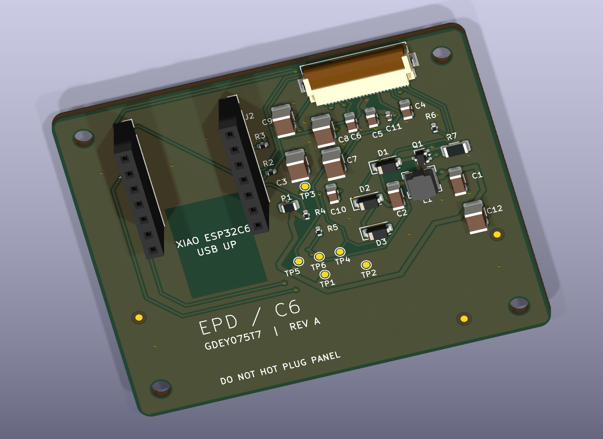

# ESP32-C6 e-paper calendar carrier — Revision A

A minimal USB-powered, socketed XIAO ESP32C6 carrier driving a bare Good Display GDEY075T7 7.5-inch 800×480 panel. The 60×50mm two-layer board includes the panel's external boost/charge-pump stage and a bottom-contact 24-pin flex connector.

**Digital implementation complete.** Native ERC/DRC are clean, the independent pin audit passes, and the calendar firmware compiles. Hardware has not been built/tested; see the review and bring-up plan before calling it a working product.

## Deliverables

- [Editable KiCad project](hardware/EPD_C6_RevA.kicad_pro), [schematic](hardware/EPD_C6_RevA.kicad_sch), [PCB](hardware/EPD_C6_RevA.kicad_pcb); project-local symbols and footprint subset.
- [Schematic PDF](docs/EPD_C6_RevA-schematic.pdf), [assembly PDF](docs/EPD_C6_RevA-assembly.pdf).
- [Fabrication ZIP](manufacturing/EPD_C6_RevA-fabrication.zip), [SMT BOM](manufacturing/BOM-JLCPCB.csv), [CPL](manufacturing/CPL-JLCPCB.csv), [manufacturing notes](manufacturing/README.md).
- [Architecture](docs/ARCHITECTURE.md), [publication review](docs/PUBLICATION_REVIEW.md), [detailed engineering review](docs/DESIGN_REVIEW_R2.md), [assembly/bring-up](docs/BRING_UP.md), [portfolio explanation](docs/PORTFOLIO.md).
- [Firmware](firmware/EPDCalendar/EPDCalendar.ino), [build instructions](firmware/README.md), [pinned versions](firmware/versions.txt). Defaults to a labeled offline calendar; optional Wi-Fi NTP.
- [Engineering BOM](bom/BOM-engineering.csv), [final assembly parts](bom/BOM-final-assembly.csv), [dated sourcing](bom/SOURCING.csv).
- [Pin audit](analysis/pin-audit.json), [ERC](analysis/erc.rpt), [DRC](analysis/drc.rpt), [release check](analysis/release-check.json), [automated analysis](analysis/final/).

25 fitted SMT components in 13 BOM groups; two hand-soldered female socket strips; four M2.5 holes. The XIAO and display are separately purchased final assembly items. No battery, extra USB connector, external RTC or cloud calendar account is required.

The panel substitution preserves the client's size/resolution/function while using an obtainable documented reference circuit. The supplied request screenshots are kept locally; the public requirements and substitutions are transcribed in the architecture document. Tools requested by the user were used: kicad-happy for analysis and KiCadRoutingTools for routing; see [provenance](docs/ATTRIBUTION.md).

## Verification and regeneration

The native KiCad files are the authoritative editable design. `hardware/design.json` and the generation/routing scripts record how Revision A was constructed; do not rerun generation over later manual edits without reviewing the resulting changes. Intermediate rejected boards are confined to `analysis/routing/`.

On this host, run `scripts/verify_and_export.sh` to repeat native checks, the pin audit, and consistent manufacturing exports from the authoritative files. First create a Python 3.11+ virtual environment (`python3 -m venv .venv`) and install `requirements.txt`. The script uses `.venv`, KiCad Python with `pcbnew`, and the KiCad CLI. Set `KICAD_CLI` / `KICAD_PYTHON` if installed elsewhere. The script does not reroute, purchase, upload or flash hardware. Firmware installation and compile instructions are documented separately. ERC/DRC return nonzero on violations, stopping exports.

A release hash pass proves output/source consistency, not electrical operation. Remaining physical acceptance items are supply overlap/inrush, bias/ripple/temperature, exact flex fit, image refresh/retention, fault recovery and RF performance near the display backplate.

## Attribution and reuse

Original project source is provided under [MIT](LICENSE). Vendored KiCad library assets retain their separate [CC-BY-SA 4.0 license and library exception](hardware/LICENSE-KiCad.md); reference documents retain their authors’ rights. See [tool and reference attribution](docs/ATTRIBUTION.md), including AI-assisted design/review and automated routing.
