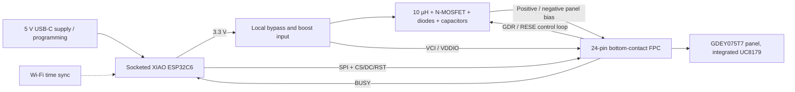

# ESP32-C6 e-paper calendar carrier — architecture baseline

Status: Revision A schematic, PCB, fabrication/assembly exports and compiled demonstration firmware implemented. Digital checks pass; physical prototype validation remains. See DESIGN_REVIEW.md for evidence and limits.

## Product and scope

Build a small USB-powered carrier for a socketed Seeed Studio XIAO ESP32C6 and a bare Good Display GDEY075T7 7.5-inch, 800 × 480 monochrome e-paper panel. The carrier contains the panel's external boost/charge-pump components and a 24-pin FPC connector. The display controller is already integrated into the panel; do not add a separate controller IC.

The product displays a calendar, obtains time over Wi-Fi, updates infrequently, and retains the image between updates. A deterministic local calendar/demo image must work without a cloud service. Revision A has no battery, RTC IC, external flash, touch, frontlight, additional USB connector, or user-interface expansion circuitry. The XIAO provides USB programming, regulation, reset/boot controls, and wireless connectivity.

This is an independent portfolio design based on the supplied brief. Describe it as designed and checked until a physical prototype has actually been tested.

## Client requirements and decisions

Source: two supplied request screenshots, reviewed visually and retained locally outside the public repository. Requirements are transcribed below.

| Client request | Revision A decision |
|---|---|
| SE0750NW31-MNG-A0, 7.5-inch B/W, 800 × 480, UC8279 | Substitute GDEY075T7, same display size/resolution/color class, UC8179. User explicitly permits comparable substitutions. |
| Original panel datasheet, page 17 reference circuit | Not supplied. Use the replacement panel's own reference circuit, not an assumed UC8279-compatible circuit. |
| Socketed XIAO ESP32-C6 | Retain two 1 × 7, 2.54 mm female socket strips; use Seeed mechanical data for row spacing and orientation. |
| 24-pin, 0.5 mm, bottom-contact ZIF FPC | Retain; select an exact MPN for the panel's approximately 0.3 mm finished flex thickness and verify contact orientation. |
| External boost circuitry with 22 µH inductor | Retain the function; replacement reference specifies 10 µH, 1 A and 0.47 Ω sensing. |
| SPI MOSI, CLK, CS, DC, RST, BUSY | Retain all six signals at 3.3 V. |
| 0402 passives where possible | Use 0402 for small logic passives. Larger packages are required where bias capacitance, voltage, pulse power, or inductance demand them. |
| JLCPCB SMT assembly, LCSC numbers | All fitted carrier SMT parts must have checked JLC assembly availability and exact LCSC identifiers. XIAO and panel are separately purchased final-assembly parts. |
| Standard two-layer PCB, about 60 × 50 mm maximum | 60 × 50 mm starting envelope, 1.6 mm FR-4, 1 oz copper, all SMT parts on top. |
| M2.5 corner mounting preferred | Four approximately 2.7 mm NPTH holes, with screw-head/component/copper clearances. Adjust within corners for connector access. |
| KiCad, Gerber, BOM, CPL | Deliver native editable sources, manufacturing files, review evidence, and assembly instructions. |
| Previous failed KiCad design as reference | Not supplied; begin from a clean design. |

Through-hole sockets may require hand assembly or a separately quoted assembly service. Do not silently replace sockets with a soldered-down XIAO to satisfy SMT sourcing.

## System architecture

The UC8179 controls its external switching stage through GDR and RESE. This is not a free-running MCU PWM supply. Firmware uses the selected panel's initialization, power-on, refresh, power-off, and sleep sequence.

### Supply strategy

Use the XIAO USB-C port with a regulated 5 V, at least 1 A wall supply for the demonstration. Carrier power comes only from XIAO 3V3 and GND. Leave the socket's 5 V pin electrically unused on the carrier; no second supply and no back-feed path.

Include an accessible 0 Ω link in the display 3.3 V branch for isolation/current measurement. Provide 100 nF and approximately 10 µF local bypass at the panel logic supply, plus the boost input capacitance prescribed by the panel reference. Do not feed external 3.3 V into panel pin 18, which is an internally regulated node requiring its own capacitor.

Seeed documents 700 mA from the 3V3 output. Treat that as a capability requiring confirmation against the actual XIAO revision, thermal conditions, and regulator loading, not an unconditional spare-current guarantee. For planning, reserve 500 mA for XIAO/radio and 150 mA for the carrier, with 50 mA headroom against a conservative 700 mA shared budget. These are design allocations, not measured maxima. The panel's quoted operating current does not bound switching startup current.

Before layout release, check the actual supply budget and boost peak current against component data. Firmware should complete Wi-Fi synchronization and turn the radio off before refresh to reduce coincident transients. Prototype testing must still include brownout recovery and accidental overlap. Do not add a separate regulator unless this analysis demonstrates a need.

### MCU signal allocation

These are XIAO labels and ESP32-C6 GPIO numbers, not female-header pad numbers. The schematic must explicitly map each socket's pad numbering from its top-view orientation.

| Net | XIAO label | ESP32-C6 GPIO | Panel pin | Direction relative to MCU |
|---|---|---:|---:|---|
| EPD_SCK | D8 | 19 | 13 | Output |
| EPD_MOSI | D10 | 18 | 14 | Output |
| EPD_CS_N | D0 | 0 | 12 | Output |
| EPD_DC | D1 | 1 | 11 | Output |
| EPD_RST_N | D2 | 2 | 10 | Output |
| EPD_BUSY_N | D3 | 21 | 9 | Input; low means busy |

No MISO is required. Keep D4/D5 and D6/D7 unused, leaving I²C/UART available on the removable module without adding carrier headers. Avoid the module's boot/strap, USB, antenna-control, and LED pins.

Use a 100 kΩ CS pull-up and a 100 kΩ RST pull-down as the initial design choice so the panel is deselected and held in reset during MCU startup. Firmware drives reset explicitly. Add 33 Ω source series resistors on SCK and MOSI near the socket; these can be changed after observing edges. Start SPI at 1 MHz, mode per the selected driver; raise only after validating the panel timing and signal integrity. No level translators or length-matching meanders are needed.

## Panel circuit baseline

Evidence: cached Good Display specification, revision 1.0 dated 2021-03-10, pages 7–10 and 40. The manufacturer's current product page identifies the same panel/controller and links a specification download, but the newest downloadable revision has not been obtained. The Global Sources copy also identifies itself as revision 1.0; it is not evidence of a newer revision.

The archived specification is sufficient to plan the architecture. Implementation must reconcile the purchased panel/FPC revision with its supporting documentation before freezing the schematic.

### Connector mapping

Use pin numbers as the primary identity. The reference drawing names pin 4 “VGL” despite marking it no-connect, and names pin 5 “VGH” where the mechanical drawing and pin table say VSHR. Pin 21/23 names also differ between the pin table and application drawing. Preserve the electrical connections below and annotate these aliases; do not join nodes merely because printed names match.

| FPC pin | Function / proposed connection |
|---:|---|
| 1 | NC; leave open |
| 2 | GDR to boost MOSFET gate |
| 3 | RESE to MOSFET source and top of current-sense resistor |
| 4 | NC; leave open |
| 5 | VSHR / reference “VGH”; dedicated 1 µF capacitor to GND, not pin 21 |
| 6, 7 | TSCL, TSDA; unused external-temperature interface, open as in reference |
| 8 | BS1 to GND for four-wire SPI |
| 9–14 | BUSY, RES, D/C, CS, SCL, SDA as mapped above |
| 15, 16 | VDDIO and VCI to display 3.3 V |
| 17 | VSS to GND |
| 18 | VDD; dedicated 1 µF capacitor to GND |
| 19 | VPP test pin; leave open as in reference |
| 20 | VSH1; dedicated 10 µF capacitor to GND |
| 21 | PREVGH / VGH; positive boost output with 10 µF to GND |
| 22 | VSL; dedicated 10 µF capacitor to GND |
| 23 | PREVGL / VGL; negative output with 10 µF to GND |
| 24 | VCOM; dedicated 1 µF capacitor to GND |

Visually audit the final connector symbol, footprint pad numbering, mating contact side, cable insertion direction, and pin 1 against the connector drawing and panel drawing. A DRC pass cannot catch a mirrored FPC connection.

### Boost circuit

Preserve this topology from page 40:

- 3.3 V → L1 → switch node SW; Q1 drain connects to SW.
- Q1 gate connects to GDR, with 1 MΩ to GND.
- Q1 source connects to RESE and a 0.47 Ω sense resistor to GND.
- Positive diode: anode SW, cathode PREVGH.
- Flying capacitor: SW to pump node.
- Clamp diode: anode pump node, cathode GND.
- Negative diode: anode PREVGL, cathode pump node.
- Output capacitors connect each bias node to GND; use nonpolar ceramic capacitors.

Reference selections are L1 = 10 µH / 1 A, Q1 = Si1308EDL, three MBR0530 diodes, flying capacitor = 4.7 µF / 50 V, input capacitor = 4.7 µF / 50 V, and bias capacitors as listed above with 50 V ratings. These are reference values, not a sourced BOM.

Final Q1 selection is SI1308EDL-T1-GE3 / C469327, and R7 is RL1206FR-7W0R47L / C859932. The engineering BOM defines all other exact selections. These preserve the reference topology. Verify FET pin order, low-gate-voltage conduction, gate charge, drain voltage and switching stress; diode reverse voltage, current and leakage; inductor saturation/RMS current and DCR; resistor pulse/average dissipation; and MLCC effective capacitance under DC bias. A “10 µF / 50 V” marking alone does not establish 10 µF in circuit. Expect 0805/1206 or larger for some bias capacitors and a larger sense resistor. Do not force these into 0402.

The generated rail voltages are set by the panel controller and firmware. Record expected operating voltages from the exact panel/controller reference before choosing stress margins and bench limits; do not infer them from the capacitor ratings.

## PCB floorplan and routing

Start at 60 × 50 mm; shrink only if the complete placement remains comfortable. Use one readable schematic sheet with labeled MCU/socket, panel, and boost sections. Keep all assembly parts on the front, with ground predominantly continuous on the back.

1. Place the XIAO along the perimeter with USB plug access, boot/reset access, and room to remove it from the sockets. Respect the module antenna keepout on both copper layers and account for the panel's conductive backplane and enclosure. Do not assume a socket height removes RF keepout requirements.
2. Place the FPC connector on an accessible edge near the panel cable, with latch opening space, insertion space, and strain relief in the mechanical assembly. Mark contact side and pin 1 on silk.
3. Cluster the boost input capacitor, L1, Q1, diodes, flying capacitor, and sense resistor beside the FPC. Minimize switching-loop area and exposed SW copper. Keep SW away from antenna, SPI, RESE, and mounting metal.
4. Take the RESE connection directly from the MOSFET-source/sense-resistor node. Return the sense resistor and local capacitors through short ground paths. Keep heavy switching return current out of the sense pickup; do not split the ground plane.
5. Place the panel's rail capacitors immediately by the associated FPC pins. Place test pads on 3V3, GND, BUSY, RST, PREVGH, and PREVGL, with a nearby ground probe pad.
6. Provide four M2.5 mounting holes, revision/panel identification, socket orientation, and readable reference designators.

Initial conservative routing targets: signals 0.25 mm; general clearance 0.20 mm; vias 0.60/0.30 mm pad/drill; supply and high-current loop routes 0.5–0.8 mm where practical with short pad neck-downs. Use at least 0.30 mm spacing between bias rails and adjacent nets where practical. These are project targets, not a claim of verified JLC limits or a substitute for stress/current checks.

Implementation: the short switching/charge-pump and sense-current paths were explicitly routed and locked. KiCadRoutingTools completed remaining bias, local-power and signal interconnects with size escalation disabled; its results were reviewed with native DRC and pin checks. Refill copper and inspect return paths after routing. No differential pairs exist on this carrier because USB stays on the XIAO.

## Firmware and demonstration

Use Arduino-ESP32 with GxEPD2's explicit GDEY075T7 driver, pinning tested versions. The upstream examples identify `GxEPD2_750_GDEY075T7`; verify its current include path during implementation.

A monochrome full frame is 800 × 480 / 8 = 48,000 bytes. Prefer a modest paged drawing buffer if Wi-Fi/library heap use is tight. Firmware first runs white/black/checkerboard/text tests, then a locally rendered monthly calendar. Network time enables a real date; a configurable fixed date allows a deterministic offline demonstration. No external calendar-account integration is required.

Sequence: configure safe GPIO states → reset/initialize exact panel → draw/update with finite BUSY timeout → panel power-off/hibernate → MCU sleep or scheduled idle. On a timeout, log the fault and reset/reinitialize with bounded retries; do not hang or refresh continuously. Use full refreshes for Revision A. Support recovery from USB removal, MCU reset, lost Wi-Fi, and invalid time without presenting a false current date.

## Completion criteria for implementation

- Native KiCad project opens with project-local custom libraries and no missing symbols/footprints.
- All 24 FPC pins and all socket contacts audited independently against physical drawings.
- Exact carrier SMT BOM has MPN, package, voltage/current ratings, LCSC number and availability check date. Separate final-assembly BOM identifies panel, XIAO, sockets and hardware.
- ERC and DRC have no unresolved errors; warnings individually explained. Final filled board has zero unintended unconnected nets and matches the schematic.
- kicad-happy schematic/PCB/cross-analysis and applicable review checks run; findings triaged against primary evidence. Reports distinguish automated consistency checks from datasheet and bench verification.
- Gerbers, drill files, BOM and CPL agree with the same final board revision. Assembly rotation/polarity and FPC orientation checked visually.
- Firmware compiles and hardware bring-up instructions identify measurement limits and test sequence.
- Fabrication-ready status is separate from physical validation. A working-product claim requires a prototype, observed panel refresh, measured supply/bias behavior, and recorded results.

## Sources

- [Seeed XIAO ESP32C6 pin map and hardware resources](https://wiki.seeedstudio.com/xiao_esp32c6_getting_started/)
- [Seeed power-pin guidance](https://wiki.seeedstudio.com/xiao_pin_multiplexing_esp32c6/)
- [Official XIAO schematic](https://files.seeedstudio.com/wiki/SeeedStudio-XIAO-ESP32C6/XIAO_ESP32_C6_v1.0_SCH_260114.pdf), cached under `references/`.
- [Good Display GDEY075T7 product](https://www.good-display.com/product/396.html)
- [Good Display specification landing page](https://www.good-display.com/companyfile/692.html)
- [Manufacturer-authored specification mirrored by LaskaKit](https://www.laskakit.cz/user/related_files/gdey075t7.pdf), cached as `references/GDEY075T7-mirror.pdf`; page 40 rendered locally.
- [GxEPD2 panel selection example](https://github.com/ZinggJM/GxEPD2/blob/master/examples/GxEPD2_HelloWorld/GxEPD2_display_selection.h)
- [kicad-happy](https://github.com/aklofas/kicad-happy) and [KiCadRoutingTools](https://github.com/drandyhaas/KiCadRoutingTools), cached and pinned by commit in `IMPLEMENTATION_HANDOFF.md`.
